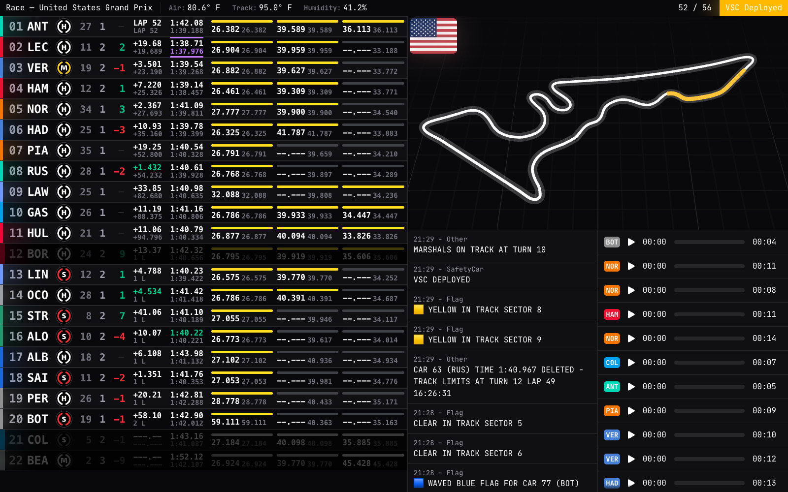
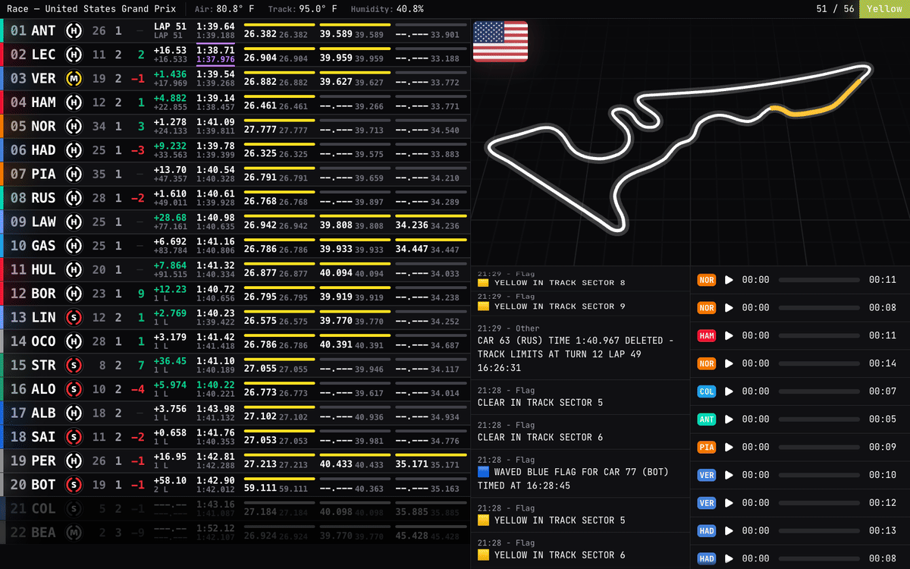
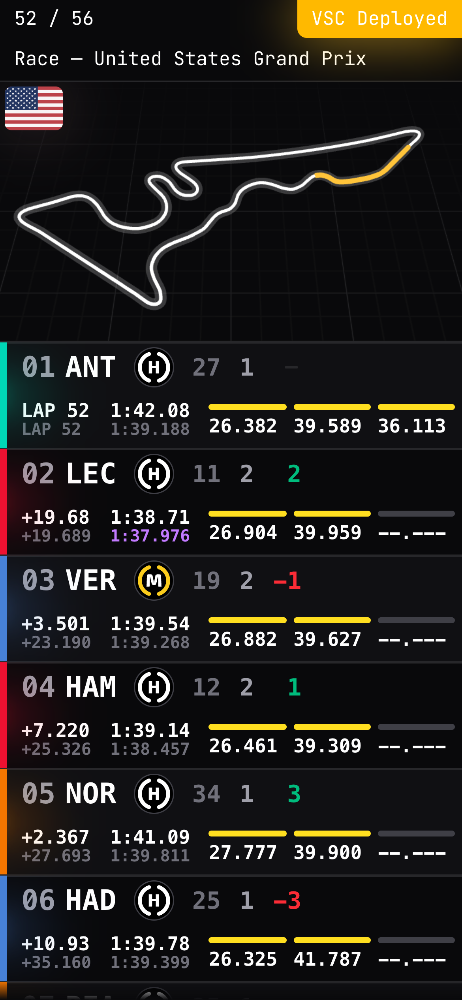
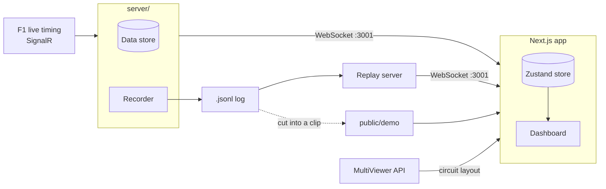

<div align="center">

# Live F1

**A real-time Formula 1 dashboard: live timing, a 3D track map with flag sectors, race control and team radio.**

[](https://live-f1.com)
[](https://live-f1.com/demo)




</div>

## Features

<table>
<tr>
<td width="72%"></td>
<td width="28%"></td>
</tr>
</table>

### Timing
- Positions, gaps, intervals, last and best laps, and all three sectors with their mini sectors.
- Purple for the overall fastest, green for a personal best.
- Tyre compound, tyre age, pit stops and places gained or lost since the start.
- Rows slide to their new place when positions change. Cars in the pit lane and retired cars dim.

### Qualifying
- Gaps and intervals for the part each driver last ran in: Q1, Q2 or Q3.
- The drop zone and the cutoff line are marked while a part runs.
- "Out Lap" shows from pit exit until the lap ends.

### 3D track map
- The circuit in 3D with orbit controls. The camera returns to its start position after 5 seconds.
- Each marshal sector turns yellow or red when race control shows a flag there.

### Race control and team radio
- Race control messages with their flags, newest first.
- Team radio clips with a player and a seek bar.

### Session
- Track status (green, yellow, safety car, VSC, red), lap count and weather.
- One layout for desktop, tablet and phone.

## How it works



- **The server** (`server/`) connects to F1's live timing feed over SignalR. It keeps the full session state and sends it to each browser over a WebSocket: first the whole state, then every change.
- **The app** (`src/`) merges each message into a Zustand store, and the dashboard renders from there.
- **The track map** comes from the MultiViewer API. It is split into marshal sectors and coloured by race control flags.
- **Recordings** save every message with a timestamp. The replay server plays them back like a live session. `/demo` plays a short clip straight in the browser, with no server.

F1 only sends data during a live session. Car positions and car telemetry need an F1 TV token, so the app does not show them.

## Getting started

You need Node 22.12 or newer and pnpm.

```bash
git clone https://github.com/bennnnzo/f1-dashboard.git
cd f1-dashboard
pnpm i
```

Start the server and the app in two terminals:

```bash
pnpm server
pnpm dev
```

Open http://localhost:3000.

The app connects to `ws://localhost:3001`. To use a different server, set `NEXT_PUBLIC_WS_URL` in `.env.local`.

## Record and replay

Record a live session to a log file:

```bash
pnpm record
```

The log goes to `server/simulate/logs/<start time>.jsonl`. If the `logs` folder does not exist, the tool asks to create it. Start it before the session starts.

Replay a log:

```bash
pnpm replay <log name>
```

The replay server uses port 3001, so stop `pnpm server` first. The replay starts when a browser connects, and it plays at 4x speed.

## Scripts

| Script | What it does |
| --- | --- |
| `pnpm dev` | Start the Next.js app in dev mode. |
| `pnpm server` | Start the server. |
| `pnpm record` | Record the F1 feed to a log file. |
| `pnpm replay <log name>` | Replay a log file. |
| `pnpm build` | Build the app and compile the server to `dist/`. |
| `pnpm start` | Start the built app. |
| `pnpm start:server` | Start the compiled server. |
| `pnpm lint` | Check the code with Biome. |
| `pnpm format` | Fix the code with Biome. |

## License

This project is licensed under the MIT License.

## Contact

For any questions or suggestions, please open an issue or contact me at [bp08262004@gmail.com].